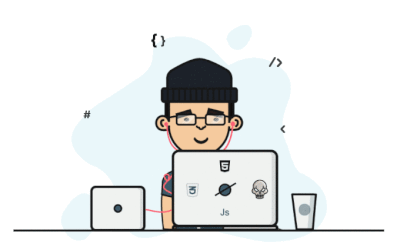
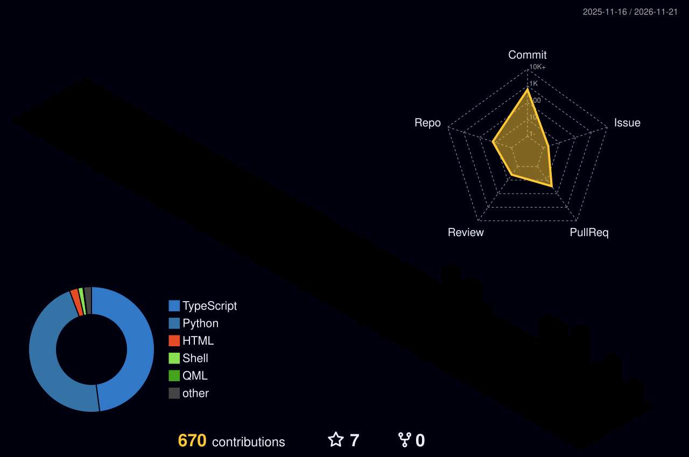
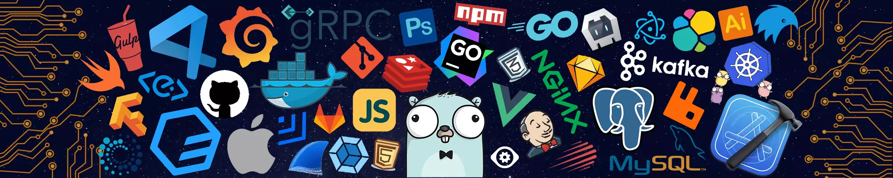

<h1 align="center">
  
  𝐇𝐞𝐥𝐥𝐨, &lt;𝚌𝚘𝚍𝚎𝚛𝚜/&gt;!
  
</h1>

<br/>
<br/>



- 👋 I’m **Rexkelly Muhoro Njoroge**, an AI/ML engineer based in Nairobi, Kenya.
- 🔭 I build **agentic AI systems, production RAG pipelines, and ML-powered applications.**
- 🌱 I’m focused on **LLM infrastructure, retrieval systems, backend engineering, and production ML.**
- 🛠️ My daily environment includes **Arch Linux, Neovim, Fish, and Git.**
- 💬 Ask me about **Python, FastAPI, AI agents, RAG, and automation** on [GitHub](https://github.com/kelly26ici).
- ⚡ I’m interested in turning models into reliable systems that retrieve, reason, and act.

<br/>
<br/>


<p align="center">
   •   
   •
   •
   •
  <a href="https://github.com/sponsors/kelly26ici"></a>
</p>

#


<p align="center">
  
  
  
</p>

#


<br/>

**𝙻𝙰𝙽𝙶𝚄𝙰𝙶𝙴𝚂 𝙰𝙽𝙳 𝚃𝙾𝙾𝙻𝚂:**  

<br/>
<br/>


<p align="center">
  <a href="https://skillicons.dev"></a>
</p>
<br/>

#

<details open="">
<summary>
  <g-emoji class="g-emoji" alias="chart_with_upwards_trend" fallback-src="https://github.githubassets.com/images/icons/emoji/unicode/1f4c8.png">📈</g-emoji>
  <strong>𝙶𝚒𝚝𝚑𝚞𝚋 𝚂𝚝𝚊𝚝𝚜 : </strong>
</summary>
<br/>

<p align="center">
    
    
</p>
</details>
<br/>




<h4 align="center">
  
```diff
+@ @ @ @ @ @ @ @ @ @ @ @ @ @ @ @ @ @ @ @ @ @ @ @ @ @ @ @+
@@       o o                                           @@
@@       | |                                           @@
@@      _L_L_                                          @@
@@   ❮\/__-__\/❯ Programming isn't about what you know @@
@@   ❮(|~o.o~|)❯  It's about what you can figure out   @@
@@   ❮/ \`-'/ \❯                                       @@
@@     _/`U'\_                                         @@
@@    ( .   . )     .----------------------------.     @@
@@   / /     \ \    | while( ! (succeed=try() ) ) |     @@
@@   \ |  ,  | /    '----------------------------'     @@
@@    \|=====|/                                        @@
@@     |_.^._|                                         @@
@@     | |"| |                                         @@
@@     ( ) ( )   Testing leads to failure              @@
@@     |_| |_|   and failure leads to understanding    @@
@@ _.-' _j L_ '-._                                     @@
@@(___.'     '.___)                                    @@
+@ @ @ @ @ @ @ @ @ @ @ @ @ @ @ @ @ @ @ @ @ @ @ @ @ @ @ @+
```

</h4>  
  


<br/>

#

<summary>
  <g-emoji class="g-emoji" alias="chart_with_upwards_trend" fallback-src="https://github.githubassets.com/images/icons/emoji/unicode/1f4c8.png">📈</g-emoji>
  <strong>𝚆𝚊𝚔𝚊𝚃𝚒𝚖𝚎 𝚂𝚝𝚊𝚝𝚜 : </strong>
</summary>

<a href="https://wakatime.com"></a>

<br>
<br>

<!--START_SECTION:waka-->
<!--END_SECTION:waka-->

<p align="center">
  <a href="https://wakatime.com">WakaTime activity</a>
</p>

#

<p align="center">
    
  <h4 align="center"><code>📊 𝙶𝚒𝚝𝙷𝚞𝚋 𝙼𝚎𝚝𝚛𝚒𝚌𝚜</code></h4>
</p>

<p align="center">
  
  
</p>

<h1>
  Connect With Me
  
</h1>

<p align="center">
  <br>
  <a href="https://www.linkedin.com/in/kelly26ici/" target="_blank">
    <code></code>
  </a>
  <a href="https://www.facebook.com/kelly26ici/" target="_blank">
    <code></code>
  </a>
  <a href="https://www.instagram.com/kelly26ici/" target="_blank">
    <code></code>
  </a>
  <a href="https://twitter.com/kelly26ici" target="_blank">
    <code></code>
  </a>
  <a href="https://dev.to/kelly26ici">
    <code></code>
  </a>     
</p>
<br/>

<p align="center">
  <a href="https://www.hackerrank.com/kelly26ici/" target="_blank">
    <code></code>
  </a>

  <a href="http://www.codeforces.com/profile/kelly26ici" target="_blank">
    <code></code>
  </a>

  <a href="https://www.hackerearth.com/@kelly26ici" target="_blank">
    <code></code>
  </a>

  <a href="https://www.codechef.com/users/kelly26ici" target="_blank">
    <code></code>
  </a>
  
  <a href="https://leetcode.com/kelly26ici/" target="_blank">
    <code></code>
  </a>
</p>

<br/>
<br/>

<div align="center">

### 𝚂𝚑𝚘𝚠 𝚜𝚘𝚖𝚎 ❤️ 𝚋𝚢 𝚜𝚝𝚊𝚛𝚛𝚒𝚗𝚐 𝚜𝚘𝚖𝚎 𝚘𝚏 𝚝𝚑𝚎 𝚛𝚎𝚙𝚘𝚜𝚒𝚝𝚘𝚛𝚒𝚎𝚜!

</div>

#

<div align="center">
  <sub>Original profile layout and visual assets by <a href="https://github.com/JayantGoel001">Jayant Goel</a>. Thank you for sharing your work.</sub>
</div>


